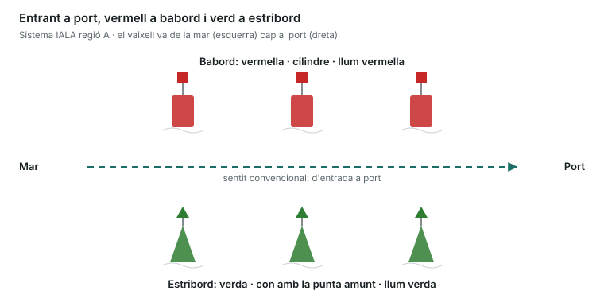
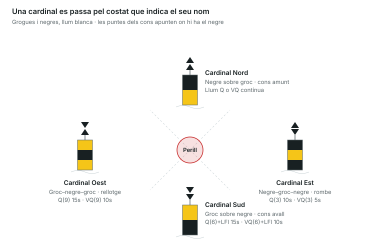

És una unitat eliminatòria: amb 3 errors suspens, encara que la resta estigui bé. Cada marca s'identifica per quatre trets: **color**, **forma**, **marca de tope** i **llum**. Espanya i tot Europa fan servir el sistema **IALA regió A**.

## Llegir una llum a la carta

| Abreviatura | Significat |
|---|---|
| F | Fixa: llum contínua |
| Fl | Llampec (destell): la llum dura menys que la foscor |
| LFl | Llampec llarg (2 s o més) |
| Q | Centellejant ràpid: 50–60 llampecs per minut |
| VQ | Centellejant molt ràpid: 100–120 per minut |
| Oc | Ocultacions: la llum dura més que la foscor |
| Iso | Isofase: llum i foscor iguals |
| Mo (A) | Morse, lletra A (punt-ratlla) |
| Al | Alternativa: canvia de color |
| Fl(2) 5s | Grup de 2 llampecs que es repeteix cada 5 s |

Colors: W blanc, R vermell, G verd, Y groc, Bu blau.

## Marques laterals

Indiquen els costats d'un canal. El **sentit convencional** del balisament és el d'**entrada a port** (venint de la mar).

- **Babord**: color **vermell**, forma **cilíndrica**, tope **cilindre vermell**, llum **vermella** de qualsevol ritme. Entrant a port, la deixes per babord (a la teva esquerra).
- **Estribord**: color **verd**, forma **cònica**, tope **con verd amb la punta amunt**, llum **verda** de qualsevol ritme. Entrant a port, la deixes per estribord (a la teva dreta).
- **Canal principal a estribord** (babord modificada): vermella amb una franja horitzontal verda; llum vermella **Fl(2+1) R**.
- **Canal principal a babord** (estribord modificada): verda amb una franja horitzontal vermella; llum verda **Fl(2+1) G**.
- Regla mnemotècnica: _"Entrant a port, vermell a l'esquerra"_. Sortint, al revés.

Sortint de port, el canal es llegeix al revés: les verdes queden a babord i les vermelles a estribord.

## Marques cardinals

Indiquen on és l'aigua navegable respecte d'un perill, segons els punts cardinals. Són **grogues i negres** i la llum, si en tenen, és **blanca** i centellejant (Q o VQ). **Has de passar pel costat que indica el nom de la marca**: per una cardinal Nord, passa pel nord.

| Marca | Tope (dos cons negres) | Colors de dalt a baix | Llum (Q / VQ) |
|---|---|---|---|
| Nord | Les dues puntes amunt | Negre sobre groc | Contínua: Q o VQ |
| Est | Bases unides (rombe) | Negre–groc–negre | Q(3) 10s / VQ(3) 5s |
| Sud | Les dues puntes avall | Groc sobre negre | Q(6)+LFl 15s / VQ(6)+LFl 10s |
| Oest | Puntes unides (rellotge de sorra) | Groc–negre–groc | Q(9) 15s / VQ(9) 10s |

- **Truc dels colors**: les puntes dels cons apunten cap a on hi ha el negre. Nord: puntes amunt → negre a dalt. Sud: puntes avall → negre a baix.
- **Truc del rellotge per a la llum**: Est = 3 llampecs (les 3), Sud = 6 (les 6), Oest = 9 (les 9), Nord = contínua (les 12). El llampec llarg de la Sud serveix per no confondre-la amb l'Est o l'Oest.

L'aigua segura és al quadrant del nom: per una cardinal Est, passa per l'est de la marca.

## Altres marques

| Marca | Color | Tope | Llum | Què vol dir |
|---|---|---|---|---|
| Perill aïllat | Negre amb franges horitzontals vermelles | 2 esferes negres | Blanca Fl(2) | Perill petit amb aigua navegable al voltant |
| Aigües navegables | Franges verticals vermelles i blanques | 1 esfera vermella | Blanca Iso, Oc, LFl 10s o Mo(A) | Aigua segura al voltant; sol marcar l'inici d'un canal |
| Especial | Groga | Aspa (X) groga | Groga, qualsevol ritme | Zones especials: bany, cables, exercicis militars, piscifactories |
| Nou perill | Franges verticals blaves i grogues | Creu (+) groga | Alternativa blava i groga Al.Bu.Y | Perill recent encara no a les cartes |

- El **nou perill** es pot senyalitzar també amb marques duplicades (laterals o cardinals) mentre no s'hagi publicat.
- Les boies grogues que limiten les **zones de bany** de les platges són marques especials.

> **Recorda per a l'examen**: entrant a port, vermell (cilindre) a babord i verd (con) a estribord. Cardinals: passa pel costat del nom; llum blanca 3–6–9 com el rellotge. Dues esferes negres = perill aïllat. Esfera vermella = aigües navegables. Aspa groga = especial. Creu groga = nou perill.
