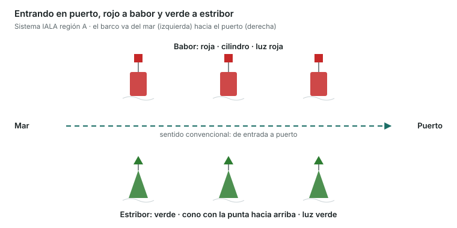
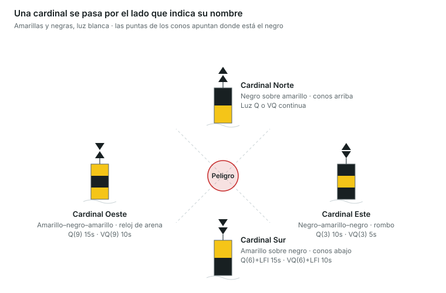

Es una unidad eliminatoria: con 3 errores suspendes, aunque el resto esté bien. Cada marca se identifica por cuatro rasgos: **color**, **forma**, **marca de tope** y **luz**. España y toda Europa usan el sistema **IALA región A**.

## Leer una luz en la carta

| Abreviatura | Significado |
|---|---|
| F | Fija: luz continua |
| Fl | Destello: la luz dura menos que la oscuridad |
| LFl | Destello largo (2 s o más) |
| Q | Centelleante rápida: 50–60 destellos por minuto |
| VQ | Centelleante muy rápida: 100–120 por minuto |
| Oc | Ocultaciones: la luz dura más que la oscuridad |
| Iso | Isofase: luz y oscuridad iguales |
| Mo (A) | Morse, letra A (punto-raya) |
| Al | Alternativa: cambia de color |
| Fl(2) 5s | Grupo de 2 destellos que se repite cada 5 s |

Colores: W blanco, R rojo, G verde, Y amarillo, Bu azul.

## Marcas laterales

Indican los lados de un canal. El **sentido convencional** del balizamiento es el de **entrada a puerto** (viniendo de la mar).

- **Babor**: color **rojo**, forma **cilíndrica**, tope **cilindro rojo**, luz **roja** de cualquier ritmo. Entrando en puerto, la dejas por babor (a tu izquierda).
- **Estribor**: color **verde**, forma **cónica**, tope **cono verde con la punta hacia arriba**, luz **verde** de cualquier ritmo. Entrando en puerto, la dejas por estribor (a tu derecha).
- **Canal principal a estribor** (babor modificada): roja con una franja horizontal verde; luz roja **Fl(2+1) R**.
- **Canal principal a babor** (estribor modificada): verde con una franja horizontal roja; luz verde **Fl(2+1) G**.
- Regla mnemotécnica: _«Entrando en puerto, rojo a la izquierda»_. Saliendo, al revés.

Saliendo de puerto, el canal se lee al revés: las verdes quedan a babor y las rojas a estribor.

## Marcas cardinales

Indican dónde está el agua navegable respecto a un peligro, según los puntos cardinales. Son **amarillas y negras** y la luz, si la tienen, es **blanca** y centelleante (Q o VQ). **Hay que pasar por el lado que indica el nombre de la marca**: por una cardinal Norte, se pasa por el norte.

| Marca | Tope (dos conos negros) | Colores de arriba abajo | Luz (Q / VQ) |
|---|---|---|---|
| Norte | Las dos puntas hacia arriba | Negro sobre amarillo | Continua: Q o VQ |
| Este | Bases unidas (rombo) | Negro–amarillo–negro | Q(3) 10s / VQ(3) 5s |
| Sur | Las dos puntas hacia abajo | Amarillo sobre negro | Q(6)+LFl 15s / VQ(6)+LFl 10s |
| Oeste | Puntas unidas (reloj de arena) | Amarillo–negro–amarillo | Q(9) 15s / VQ(9) 10s |

- **Truco de los colores**: las puntas de los conos apuntan hacia donde está el negro. Norte: puntas arriba → negro arriba. Sur: puntas abajo → negro abajo.
- **Truco del reloj para la luz**: Este = 3 destellos (las 3), Sur = 6 (las 6), Oeste = 9 (las 9), Norte = continua (las 12). El destello largo de la Sur sirve para no confundirla con la Este o la Oeste.

El agua segura está en el cuadrante del nombre: por una cardinal Este, pasa por el este de la marca.

## Otras marcas

| Marca | Color | Tope | Luz | Qué significa |
|---|---|---|---|---|
| Peligro aislado | Negro con franjas horizontales rojas | 2 esferas negras | Blanca Fl(2) | Peligro pequeño con agua navegable alrededor |
| Aguas navegables | Franjas verticales rojas y blancas | 1 esfera roja | Blanca Iso, Oc, LFl 10s o Mo(A) | Agua segura alrededor; suele marcar el inicio de un canal |
| Especial | Amarilla | Aspa (X) amarilla | Amarilla, cualquier ritmo | Zonas especiales: baño, cables, ejercicios militares, piscifactorías |
| Nuevo peligro | Franjas verticales azules y amarillas | Cruz (+) amarilla | Alternativa azul y amarilla Al.Bu.Y | Peligro reciente aún no reflejado en las cartas |

- El **nuevo peligro** también puede señalizarse con marcas duplicadas (laterales o cardinales) mientras no se haya publicado.
- Las boyas amarillas que limitan las **zonas de baño** de las playas son marcas especiales.

> **Recuerda para el examen**: entrando en puerto, rojo (cilindro) a babor y verde (cono) a estribor. Cardinales: pasa por el lado del nombre; luz blanca 3–6–9 como el reloj. Dos esferas negras = peligro aislado. Esfera roja = aguas navegables. Aspa amarilla = especial. Cruz amarilla = nuevo peligro.
