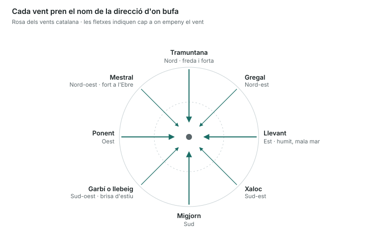

Cal saber llegir un mapa d'isòbares, conèixer les escales Beaufort i Douglas i entendre les brises i els fronts.

## Pressió atmosfèrica

- Es mesura amb el **baròmetre**, en **hectopascals (hPa)** o mil·libars (són el mateix). La pressió mitjana al nivell del mar és **1013 hPa**.
- Les **isòbares** són línies que uneixen punts amb la mateixa pressió. Com més **juntes**, més **vent**.
- **Borrasca o depressió (B / L)**: pressió baixa al centre. A l'hemisferi nord el vent hi gira en **sentit antihorari** i convergent. Porta núvols, pluja i mal temps.
- **Anticicló (A / H)**: pressió alta al centre. El vent hi gira en **sentit horari** i divergent. Porta temps estable i calma.
- **Llei de Buys-Ballot** (hemisferi nord): si et poses d'esquena al vent, les baixes pressions queden a la teva **esquerra**.
- Una **baixada ràpida** del baròmetre anuncia empitjorament i vent fort.

## Masses d'aire i fronts

- **Front fred**: l'aire fred empeny el càlid. Núvols de desenvolupament vertical (cumulonimbus), xàfecs, tempestes i ratxes fortes. Després aclareix ràpid i baixa la temperatura.
- **Front càlid**: l'aire càlid puja sobre el fred. Núvols estratificats, pluja contínua i feble, boira. Arriba de manera gradual.
- **Front oclús**: el fred atrapa el càlid; barreja de tots dos.

## Vents locals i brises

- **Brisa marina**: de dia la terra s'escalfa més que el mar; el vent bufa **del mar cap a terra** a partir del migdia.
- **Terral**: de nit la terra es refreda més; el vent bufa **de terra cap al mar**, més feble.
- **Vents de Catalunya**: tramuntana (N) freda, forta i seca, perillosa al cap de Creus i al golf de Lleó; llevant (E) humit i amb mala mar; garbí (SW) la brisa d'estiu; mestral (NW) fort a les Terres de l'Ebre.
- **Rosa dels vents**: tramuntana N · gregal NE · llevant E · xaloc SE · migjorn S · garbí o llebeig SW · ponent W · mestral NW.
- El vent s'anomena per la direcció **d'on ve** (un vent de nord ve del nord).

Un vent de tramuntana ve del nord i empeny cap al sud: per això aixeca mala mar al cap de Creus i al golf de Lleó.

## Escala Beaufort (força del vent)

| Força | Nom | Nusos | Aspecte del mar |
|---|---|---|---|
| 0 | Calma | < 1 | Com un mirall |
| 1 | Ventolina | 1–3 | Petites arrugues |
| 2 | Vent molt fluix (flojito) | 4–6 | Onetes curtes |
| 3 | Vent fluix (flojo) | 7–10 | Onetes amb algun borrallo |
| 4 | Bonancenc (bonancible) | 11–16 | Onades petites, borrallons freqüents |
| 5 | Fresquet (fresquito) | 17–21 | Onades moderades, molts borrallons |
| 6 | Fresc (fresco) | 22–27 | Onades grans, crestes d'escuma |
| 7 | Fort (frescachón) | 28–33 | Mar gruixuda, escuma en franges |
| 8 | Temporal | 34–40 | Onades altes, l'escuma vola |
| 9 | Temporal fort | 41–47 | Onades molt altes, visibilitat afectada |
| 10 | Temporal dur | 48–55 | Mar blanca, rompents forts |
| 11 | Temporal molt dur | 56–63 | Onades excepcionalment altes |
| 12 | Temporal huracanat | 64 o més | Aire ple d'escuma i esquitxos |

## Escala Douglas (estat de la mar de vent)

| Grau | Nom | Altura de les onades |
|---|---|---|
| 0 | Calma (llana) | 0 m |
| 1 | Arrissada (rizada) | 0–0,1 m |
| 2 | Marejol (marejadilla) | 0,1–0,5 m |
| 3 | Maror (marejada) | 0,5–1,25 m |
| 4 | Maror forta (fuerte marejada) | 1,25–2,5 m |
| 5 | Mar brava (gruesa) | 2,5–4 m |
| 6 | Mar molt brava (muy gruesa) | 4–6 m |
| 7 | Mar desfeta (arbolada) | 6–9 m |
| 8 | Mar molt desfeta (montañosa) | 9–14 m |
| 9 | Mar enorme | més de 14 m |

## Onades i boira

- **Mar de vent**: onades creades pel vent que bufa en aquell moment al lloc; irregulars i amb crestes.
- **Mar de fons**: onades llargues i regulars que arriben d'un temporal llunyà, encara que aquí no faci vent.
- **Boira d'advecció**: aire càlid i humit que passa sobre aigua freda; típica al mar i pot durar dies.
- **Boira de radiació**: es forma de nit sobre terra en calma; es dissipa amb el sol.

## On consultar la previsió

- **AEMET** i **Meteocat** (predicció marítima i avisos).
- **Salvament Marítim** emet butlletins per VHF després d'anunciar-los pel canal 16.
- **NAVTEX** (518 kHz): rep avisos meteorològics i de navegació per escrit.

> **Recorda per a l'examen**: 1013 hPa = normal. Isòbares juntes = vent fort. Borrasca gira antihorari a l'hemisferi nord. Brisa de dia del mar a terra; terral de nit. Força 8 = temporal (34–40 nusos). Mar de fons ve de lluny.
