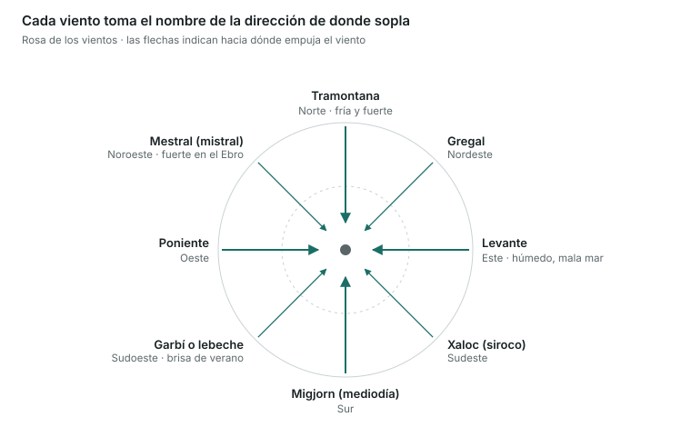

Hay que saber leer un mapa de isobaras, conocer las escalas Beaufort y Douglas y entender las brisas y los frentes.

## Presión atmosférica

- Se mide con el **barómetro**, en **hectopascales (hPa)** o milibares (son lo mismo). La presión media al nivel del mar es **1013 hPa**.
- Las **isobaras** son líneas que unen puntos con la misma presión. Cuanto más **juntas**, más **viento**.
- **Borrasca o depresión (B / L)**: presión baja en el centro. En el hemisferio norte el viento gira en **sentido antihorario** y convergente. Trae nubes, lluvia y mal tiempo.
- **Anticiclón (A / H)**: presión alta en el centro. El viento gira en **sentido horario** y divergente. Trae tiempo estable y calma.
- **Ley de Buys-Ballot** (hemisferio norte): si te pones de espaldas al viento, las bajas presiones quedan a tu **izquierda**.
- Una **bajada rápida** del barómetro anuncia empeoramiento y viento fuerte.

## Masas de aire y frentes

- **Frente frío**: el aire frío empuja al cálido. Nubes de desarrollo vertical (cumulonimbos), chubascos, tormentas y rachas fuertes. Después aclara rápido y baja la temperatura.
- **Frente cálido**: el aire cálido sube sobre el frío. Nubes estratificadas, lluvia continua y débil, niebla. Llega de forma gradual.
- **Frente ocluido**: el frío alcanza al cálido; mezcla de ambos.

## Vientos locales y brisas

- **Brisa marina**: de día la tierra se calienta más que el mar; el viento sopla **del mar hacia tierra** a partir del mediodía.
- **Terral**: de noche la tierra se enfría más; el viento sopla **de tierra hacia el mar**, más flojo.
- **Vientos de Cataluña**: tramontana (N) fría, fuerte y seca, peligrosa en el cabo de Creus y el golfo de León; levante (E) húmedo y con mala mar; lebeche o garbí (SW), la brisa de verano; mistral (NW) fuerte en las Terres de l'Ebre.
- **Rosa de los vientos**: tramontana N · gregal NE · levante E · siroco (xaloc) SE · mediodía (migjorn) S · lebeche (garbí) SW · poniente W · mistral NW.
- El viento se nombra por la dirección **de donde viene** (un viento del norte viene del norte).

La tramontana viene del norte y empuja hacia el sur: por eso levanta mala mar en el cabo de Creus y el golfo de León.

## Escala Beaufort (fuerza del viento)

| Fuerza | Nombre | Nudos | Aspecto del mar |
|---|---|---|---|
| 0 | Calma | < 1 | Como un espejo |
| 1 | Ventolina | 1–3 | Pequeñas arrugas |
| 2 | Flojito | 4–6 | Olas cortas |
| 3 | Flojo | 7–10 | Olas pequeñas con algún borreguillo |
| 4 | Bonancible | 11–16 | Olas pequeñas, borreguillos frecuentes |
| 5 | Fresquito | 17–21 | Olas moderadas, muchos borreguillos |
| 6 | Fresco | 22–27 | Olas grandes, crestas de espuma |
| 7 | Frescachón | 28–33 | Mar gruesa, espuma en franjas |
| 8 | Temporal | 34–40 | Olas altas, la espuma vuela |
| 9 | Temporal fuerte | 41–47 | Olas muy altas, visibilidad afectada |
| 10 | Temporal duro | 48–55 | Mar blanca, rompientes fuertes |
| 11 | Temporal muy duro | 56–63 | Olas excepcionalmente altas |
| 12 | Temporal huracanado | 64 o más | Aire lleno de espuma y rociones |

## Escala Douglas (estado de la mar de viento)

| Grado | Nombre | Altura de las olas |
|---|---|---|
| 0 | Calma (llana) | 0 m |
| 1 | Rizada | 0–0,1 m |
| 2 | Marejadilla | 0,1–0,5 m |
| 3 | Marejada | 0,5–1,25 m |
| 4 | Fuerte marejada | 1,25–2,5 m |
| 5 | Gruesa | 2,5–4 m |
| 6 | Muy gruesa | 4–6 m |
| 7 | Arbolada | 6–9 m |
| 8 | Montañosa | 9–14 m |
| 9 | Enorme | más de 14 m |

## Olas y niebla

- **Mar de viento**: olas creadas por el viento que sopla en ese momento en el lugar; irregulares y con crestas.
- **Mar de fondo**: olas largas y regulares que llegan de un temporal lejano, aunque aquí no haga viento.
- **Niebla de advección**: aire cálido y húmedo que pasa sobre agua fría; típica en el mar y puede durar días.
- **Niebla de radiación**: se forma de noche sobre tierra en calma; se disipa con el sol.

## Dónde consultar la previsión

- **AEMET** y **Meteocat** (predicción marítima y avisos).
- **Salvamento Marítimo** emite boletines por VHF tras anunciarlos por el canal 16.
- **NAVTEX** (518 kHz): recibe avisos meteorológicos y de navegación por escrito.

> **Recuerda para el examen**: 1013 hPa = normal. Isobaras juntas = viento fuerte. La borrasca gira en sentido antihorario en el hemisferio norte. Brisa de día del mar a tierra; terral de noche. Fuerza 8 = temporal (34–40 nudos). La mar de fondo viene de lejos.
