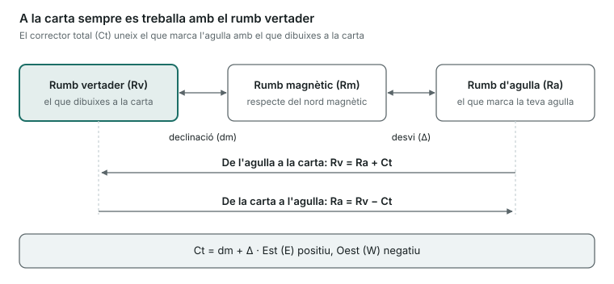

Aquesta unitat és la base de la carta: coordenades, unitats, rumbs, correccions de l'agulla i demores. Si l'entens bé, la Unitat 11 és pràctica mecànica.

## Coordenades i unitats

- **Latitud (l)**: distància angular d'un punt a l'equador, de 0° a 90° **Nord** o **Sud**. Es llegeix a l'**escala vertical** (lateral) de la carta.
- **Longitud (L)**: distància angular d'un punt al meridià de Greenwich, de 0° a 180° **Est** o **Oest**. Es llegeix a l'**escala horitzontal** (superior o inferior).
- 1° = 60 minuts (60'); 1' = 60 segons o, en cartes, es divideix en dècimes.
- **Milla nàutica**: 1 minut de latitud = **1852 m**.
- **Nus**: 1 milla per hora.
- **Les distàncies es mesuren sempre a l'escala de latituds** (la lateral), a l'altura on mesures. Mai a l'escala de longituds.

## Cartes nàutiques

- Fan servir la **projecció Mercator**: els meridians i els paral·lels són rectes perpendiculars i els rumbs es dibuixen com a línies rectes (**loxodròmiques**).
- **Escala**: com més gran és el denominador (1:500.000), menys detall; les cartes de port són d'escala gran (1:10.000).
- Mostren sondes (profunditats), naturalesa del fons, llums, marques, perills i la **declinació magnètica** de l'any amb la seva variació anual.

## L'agulla i els tres nords

- **Nord vertader (Nv)**: el nord geogràfic, el de la carta.
- **Nord magnètic (Nm)**: on apunta una agulla sense interferències.
- **Nord d'agulla (Na)**: on apunta l'agulla del teu vaixell, desviada pels ferros i aparells de bord.
- **Declinació magnètica (dm)**: angle entre el nord vertader i el magnètic. Ve a la carta i canvia amb els anys.
- **Desvi (Δ)**: angle entre el nord magnètic i el d'agulla. Depèn del rumb del vaixell i es treu de la **taula de desvis**.
- **Corrector total (Ct)**: la suma dels dos. Convenció de signes: **Est = +**, **Oest = −**.

**Ct = dm + Δ**

Per anar de l'agulla a la carta se suma el Ct amb el seu signe; per anar de la carta a l'agulla, es resta.

## Rumbs

- **Rumb vertader (Rv)**: angle des del nord vertader fins a la proa. És el que es dibuixa a la carta.
- **Rumb d'agulla (Ra)**: el que marca la teva agulla.
- **Rumb magnètic (Rm)**: referit al nord magnètic.

**Rv = Ra + Ct  ·  Ra = Rv − Ct**

Exemple: Ra = 100°, dm = 3° W (−3°), Δ = +1° → Ct = −2° → Rv = 98°.

## Demores i marcacions

- **Demora**: angle des del nord fins a la direcció en què veus un objecte. Pot ser vertadera (Dv) o d'agulla (Da). Es corregeix igual que el rumb: Dv = Da + Ct.
- **Marcació (M)**: angle des de la **proa** fins a l'objecte. Si es compta de 0° a 180° per cada banda, a estribord és positiva i a babord negativa.

**Dv = Rv + M**

- **Enfilació**: quan veus dues marques de terra alineades. La carta et dona la demora vertadera de la línia; si la prens amb l'agulla, obtens el corrector total: Ct = Dv − Da.

## Velocitat, distància i temps

**D = V × t**

Exemple: a 12 nusos durant 1 h 30 min recorres 12 × 1,5 = 18 milles.

## Abatiment i corrent

- **Abatiment**: el desplaçament lateral que provoca el vent. Si el vent entra per **babord**, et desvia cap a estribord (abatiment **+**); si entra per **estribord**, cap a babord (**−**). El rumb de superfície és Rs = Rv + abatiment.
- **Corrent**: té **rumb** (cap a on va) i **intensitat** (en nusos). El teu moviment real sobre el fons és el **rumb efectiu** i la **velocitat efectiva**, que surten de sumar el vector del vaixell i el del corrent.

## Marees

- **Plenamar** (aigua alta) i **baixamar** (aigua baixa) es repeteixen aproximadament cada 6 hores.
- **Amplitud**: diferència d'altura entre plenamar i baixamar. A la Mediterrània és molt petita; a l'Atlàntic (Estret, Cantàbric, Galícia) és important.
- **Marees vives** (lluna nova i plena): amplitud màxima. **Marees mortes** (quarts): mínima.

> **Recorda per a l'examen**: 1 milla = 1' de latitud = 1852 m. Distàncies a l'escala lateral. Ct = dm + Δ, Est positiu i Oest negatiu. Rv = Ra + Ct. Dv = Rv + M. Vent per babord = abatiment positiu.
