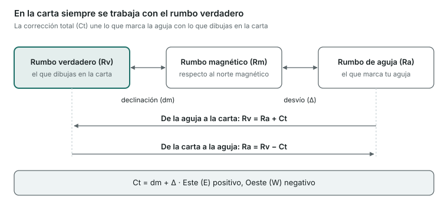

Esta unidad es la base de la carta: coordenadas, unidades, rumbos, correcciones de la aguja y demoras. Si la entiendes bien, la de Carta es práctica mecánica.

## Coordenadas y unidades

- **Latitud (l)**: distancia angular de un punto al ecuador, de 0° a 90° **Norte** o **Sur**. Se lee en la **escala vertical** (lateral) de la carta.
- **Longitud (L)**: distancia angular de un punto al meridiano de Greenwich, de 0° a 180° **Este** u **Oeste**. Se lee en la **escala horizontal** (superior o inferior).
- 1° = 60 minutos (60'); 1' = 60 segundos o, en las cartas, se divide en décimas.
- **Milla náutica**: 1 minuto de latitud = **1852 m**.
- **Nudo**: 1 milla por hora.
- **Las distancias se miden siempre en la escala de latitudes** (la lateral), a la altura donde mides. Nunca en la escala de longitudes.

## Cartas náuticas

- Usan la **proyección Mercator**: los meridianos y los paralelos son rectas perpendiculares y los rumbos se dibujan como líneas rectas (**loxodrómicas**).
- **Escala**: cuanto mayor es el denominador (1:500.000), menos detalle; las cartas de puerto son de escala grande (1:10.000).
- Muestran sondas (profundidades), naturaleza del fondo, luces, marcas, peligros y la **declinación magnética** del año con su variación anual.

## La aguja y los tres nortes

- **Norte verdadero (Nv)**: el norte geográfico, el de la carta.
- **Norte magnético (Nm)**: hacia donde apunta una aguja sin interferencias.
- **Norte de aguja (Na)**: hacia donde apunta la aguja de tu barco, desviada por los hierros y aparatos de a bordo.
- **Declinación magnética (dm)**: ángulo entre el norte verdadero y el magnético. Viene en la carta y cambia con los años.
- **Desvío (Δ)**: ángulo entre el norte magnético y el de aguja. Depende del rumbo del barco y se saca de la **tablilla de desvíos**.
- **Corrección total (Ct)**: la suma de los dos. Convenio de signos: **Este = +**, **Oeste = −**.

**Ct = dm + Δ**

Para pasar de la aguja a la carta se suma la Ct con su signo; para pasar de la carta a la aguja, se resta.

## Rumbos

- **Rumbo verdadero (Rv)**: ángulo desde el norte verdadero hasta la proa. Es el que se dibuja en la carta.
- **Rumbo de aguja (Ra)**: el que marca tu aguja.
- **Rumbo magnético (Rm)**: referido al norte magnético.

**Rv = Ra + Ct  ·  Ra = Rv − Ct**

Ejemplo: Ra = 100°, dm = 3° W (−3°), Δ = +1° → Ct = −2° → Rv = 98°.

## Demoras y marcaciones

- **Demora**: ángulo desde el norte hasta la dirección en que ves un objeto. Puede ser verdadera (Dv) o de aguja (Da). Se corrige igual que el rumbo: Dv = Da + Ct.
- **Marcación (M)**: ángulo desde la **proa** hasta el objeto. Si se cuenta de 0° a 180° por cada banda, a estribor es positiva y a babor negativa.

**Dv = Rv + M**

- **Enfilación**: cuando ves dos marcas de tierra alineadas. La carta te da la demora verdadera de la línea; si la tomas con la aguja, obtienes la corrección total: Ct = Dv − Da.

## Velocidad, distancia y tiempo

**D = V × t**

Ejemplo: a 12 nudos durante 1 h 30 min recorres 12 × 1,5 = 18 millas.

## Abatimiento y corriente

- **Abatimiento**: el desplazamiento lateral que provoca el viento. Si el viento entra por **babor**, te desvía hacia estribor (abatimiento **+**); si entra por **estribor**, hacia babor (**−**). El rumbo de superficie es Rs = Rv + abatimiento.
- **Corriente**: tiene **rumbo** (hacia dónde va) e **intensidad** (en nudos). Tu movimiento real sobre el fondo es el **rumbo efectivo** y la **velocidad efectiva**, que salen de sumar el vector del barco y el de la corriente.

## Mareas

- **Pleamar** (agua alta) y **bajamar** (agua baja) se repiten aproximadamente cada 6 horas.
- **Amplitud**: diferencia de altura entre pleamar y bajamar. En el Mediterráneo es muy pequeña; en el Atlántico (Estrecho, Cantábrico, Galicia) es importante.
- **Mareas vivas** (luna nueva y llena): amplitud máxima. **Mareas muertas** (cuartos): mínima.

> **Recuerda para el examen**: 1 milla = 1' de latitud = 1852 m. Distancias en la escala lateral. Ct = dm + Δ, Este positivo y Oeste negativo. Rv = Ra + Ct. Dv = Rv + M. Viento por babor = abatimiento positivo.
