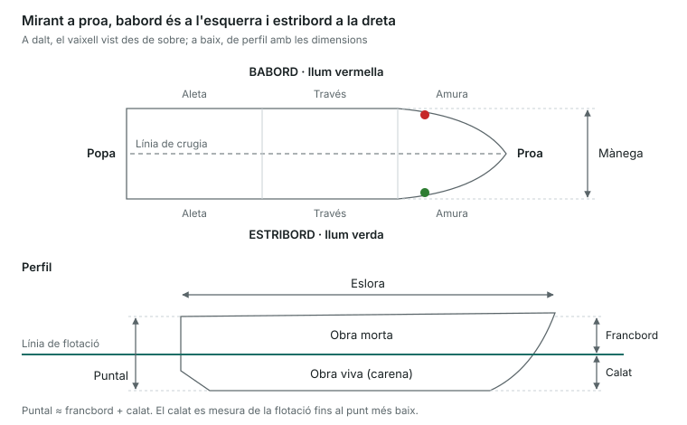

Aquesta unitat és vocabulari: si saps situar cada part del vaixell i cada dimensió, les 4 preguntes són gairebé segures.

## Orientació a bord

- **Proa**: la part davantera. **Popa**: la part del darrere.
- **Estribord**: el costat dret mirant cap a proa (llum verda). **Babord**: el costat esquerre (llum vermella).
- **Línia de crugia**: l'eix imaginari de proa a popa que divideix el vaixell en dues meitats iguals.
- **Amura**: la zona del costat a prop de la proa. **Aleta**: la zona del costat a prop de la popa. **Través**: la direcció perpendicular a la crugia, al mig del vaixell.
- Un objecte es pot veure "per l'amura d'estribord", "pel través de babord", "per l'aleta d'estribord", etc.

## El buc i la seva estructura

| Terme | Què és |
|---|---|
| Buc | El cos del vaixell, sense pals ni equips |
| Línia de flotació | La línia on la superfície de l'aigua toca el buc |
| Obra viva (carena) | La part del buc submergida, per sota de la flotació |
| Obra morta | La part del buc que queda fora de l'aigua |
| Quilla | La peça longitudinal de la part més baixa, l'espinada del vaixell |
| Roda | La peça que continua la quilla cap amunt a proa |
| Codast | La peça que tanca la quilla a popa; hi va el timó |
| Mirall de popa | La superfície plana que tanca la popa |
| Quadernes | Les costelles transversals que donen forma al buc |
| Baus | Les bigues transversals que sostenen la coberta |
| Coberta | El pis superior que tanca el buc |
| Sentina | La part més baixa de l'interior, on s'acumula l'aigua |
| Borda / regala | La vora superior del costat del buc |
| Bancada / banyera | Seient i zona oberta de popa on va la tripulació |
| Imbornals | Forats que desguassen l'aigua de la coberta cap a fora |
| Portell / escotilla | Obertura al costat / obertura a la coberta |
| Candelers i guardamà | Puntals i cable que fan de barana |

## Dimensions principals

- **Eslora**: la llargada. L'eslora total va del punt més a proa al més a popa; l'eslora de flotació es mesura a la línia de flotació.
- **Mànega**: l'amplada màxima del buc.
- **Puntal**: l'alçada des de la quilla fins a la coberta.
- **Calat**: la distància vertical de la línia de flotació al punt més baix del buc (quilla, orsa o hèlix). Indica la profunditat mínima per navegar.
- **Francbord**: la distància vertical de la línia de flotació a la coberta. Puntal = calat + francbord (aproximadament).
- **Desplaçament**: el pes del vaixell, igual al pes de l'aigua que desplaça (principi d'Arquimedes).
- **Assentament**: la diferència entre el calat de popa i el de proa. Vaixell **apopat** (popa més enfonsada) o **aproat** (proa més enfonsada).
- **Escora**: inclinació transversal cap a una banda.

La línia de flotació separa l'obra viva (sota l'aigua) de l'obra morta; el calat i el francbord es mesuren a partir d'aquesta línia.

## Govern i propulsió

- **Timó**: format per la **pala** i la **mitjacanya**, que es mou amb una **canya** o una **roda de timó**.
- **Hèlix**: converteix el gir del motor en empenta. **Dextrogira** gira en sentit horari vista des de popa quan va avant; **levogira**, en sentit contrari. El **pas** és el que avançaria l'hèlix en una volta sense lliscar.
- Tipus de motor: intraborda (a dins, amb eix i hèlix), fueraborda (penjat al mirall) i intrafueraborda o cua (motor a dins, cua orientable a fora).

## Velers, el bàsic

- **Pal** (vertical) i **botavara** (horitzontal, a la base de la vela major).
- **Estais** (sostenen el pal de proa a popa) i **obenques** (el sostenen pels costats): és la **maniobra fixa**.
- **Drisses** (pugen les veles) i **escotes** (les cacen o les amollen): és la **maniobra de treball**.
- **Orsa**: aleta sota el buc que impedeix la deriva i dona estabilitat.

> **Recorda per a l'examen**: estribord = verd = dreta; babord = vermell = esquerra. Obra viva és sota l'aigua, obra morta fora. El calat va de la flotació cap avall; el francbord, de la flotació cap amunt.
