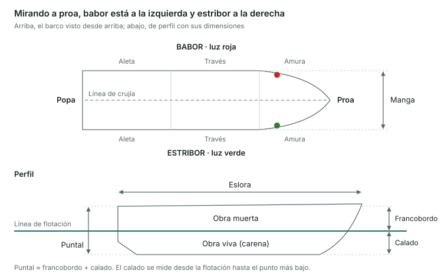

Esta unidad es vocabulario: si sabes situar cada parte del barco y cada dimensión, las 4 preguntas son casi seguras.

## Orientación a bordo

- **Proa**: la parte delantera. **Popa**: la parte trasera.
- **Estribor**: el costado derecho mirando hacia proa (luz verde). **Babor**: el costado izquierdo (luz roja).
- **Línea de crujía**: el eje imaginario de proa a popa que divide el barco en dos mitades iguales.
- **Amura**: la zona del costado cerca de la proa. **Aleta**: la zona del costado cerca de la popa. **Través**: la dirección perpendicular a la crujía, en el centro del barco.
- Un objeto se puede ver «por la amura de estribor», «por el través de babor», «por la aleta de estribor», etc.

## El casco y su estructura

| Término | Qué es |
|---|---|
| Casco | El cuerpo del barco, sin palos ni equipos |
| Línea de flotación | La línea donde la superficie del agua toca el casco |
| Obra viva (carena) | La parte del casco sumergida, por debajo de la flotación |
| Obra muerta | La parte del casco que queda fuera del agua |
| Quilla | La pieza longitudinal de la parte más baja, la columna vertebral del barco |
| Roda | La pieza que continúa la quilla hacia arriba en proa |
| Codaste | La pieza que cierra la quilla en popa; en ella va el timón |
| Espejo de popa | La superficie plana que cierra la popa |
| Cuadernas | Las costillas transversales que dan forma al casco |
| Baos | Las vigas transversales que sostienen la cubierta |
| Cubierta | El piso superior que cierra el casco |
| Sentina | La parte más baja del interior, donde se acumula el agua |
| Borda / regala | El borde superior del costado del casco |
| Bancada / bañera | Asiento y zona abierta de popa donde va la tripulación |
| Imbornales | Orificios que desaguan el agua de la cubierta hacia fuera |
| Portillo / escotilla | Abertura en el costado / abertura en la cubierta |
| Candeleros y guardamancebos | Puntales y cable que hacen de barandilla |

## Dimensiones principales

- **Eslora**: la longitud. La eslora total va del punto más a proa al más a popa; la eslora de flotación se mide en la línea de flotación.
- **Manga**: la anchura máxima del casco.
- **Puntal**: la altura desde la quilla hasta la cubierta.
- **Calado**: la distancia vertical de la línea de flotación al punto más bajo del casco (quilla, orza o hélice). Indica la profundidad mínima para navegar.
- **Francobordo**: la distancia vertical de la línea de flotación a la cubierta. Puntal = calado + francobordo (aproximadamente).
- **Desplazamiento**: el peso del barco, igual al peso del agua que desplaza (principio de Arquímedes).
- **Asiento**: la diferencia entre el calado de popa y el de proa. Barco **apopado** (popa más hundida) o **aproado** (proa más hundida).
- **Escora**: inclinación transversal hacia una banda.

La línea de flotación separa la obra viva (bajo el agua) de la obra muerta; el calado y el francobordo se miden a partir de esa línea.

## Gobierno y propulsión

- **Timón**: formado por la **pala** y la **mecha**, que se mueve con una **caña** o una **rueda de timón**.
- **Hélice**: convierte el giro del motor en empuje. La **dextrógira** gira en sentido horario vista desde popa cuando va avante; la **levógira**, en sentido contrario. El **paso** es lo que avanzaría la hélice en una vuelta sin resbalar.
- Tipos de motor: intraborda (dentro, con eje y hélice), fueraborda (colgado del espejo) e intrafueraborda o cola (motor dentro, cola orientable fuera).

## Veleros, lo básico

- **Palo** (vertical) y **botavara** (horizontal, en la base de la vela mayor).
- **Estays** (sostienen el palo de proa a popa) y **obenques** (lo sostienen por los costados): es la **jarcia firme**.
- **Drizas** (izan las velas) y **escotas** (las cazan o las amollan): es la **jarcia de labor**.
- **Orza**: aleta bajo el casco que impide la deriva y da estabilidad.

> **Recuerda para el examen**: estribor = verde = derecha; babor = rojo = izquierda. Obra viva es bajo el agua, obra muerta fuera. El calado va de la flotación hacia abajo; el francobordo, de la flotación hacia arriba.
