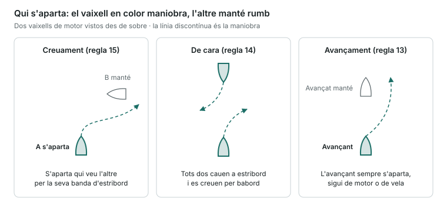
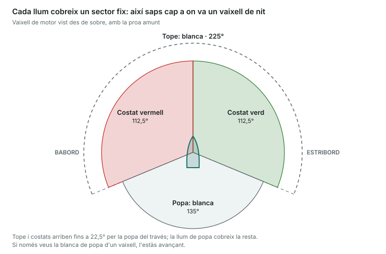

És la unitat amb més pes: 10 preguntes i eliminatòria. Has de dominar qui s'aparta en cada situació, els llums i marques i els senyals acústics.

## Definicions que cal saber

- **Buc de propulsió mecànica**: qualsevol que es mou amb motor. Un veler que navega amb motor ho és, encara que porti veles.
- **Vaixell de vela**: navega només a vela.
- **Vaixell dedicat a la pesca**: pesca amb arts que li limiten la maniobra (xarxes, palangres, arrossegament). No inclou la pesca amb canya o curricà.
- **Vaixell sense govern**: per alguna circumstància excepcional no pot maniobrar (avaria de motor o timó).
- **Vaixell amb capacitat de maniobra restringida**: per la feina que fa no pot apartar-se (dragatges, cables submarins, operacions de bussos, remolcs difícils).
- **Vaixell restringit pel seu calat**: un vaixell gran que, pel seu calat respecte de la profunditat, no pot desviar-se del rumb.
- **En navegació**: no està fondejat, ni amarrat, ni varat.
- **Visibilitat reduïda**: per boira, pluja, neu o fum.

## Regles de rumb i govern

- **Regla 5 · Vigilància**: cal mantenir sempre una vigilància visual i auditiva eficaç (i amb radar si se'n té).
- **Regla 6 · Velocitat de seguretat**: la que permet aturar-se o maniobrar a temps segons la visibilitat, el trànsit i el mar.
- **Regla 7 · Risc d'abordatge**: hi ha risc si la **demora** de l'altre vaixell **no canvia** i la distància disminueix. Si tens dubtes, considera que hi ha risc.
- **Regla 8 · Maniobres**: han de ser **clares, amb antelació i amples**, perquè l'altre les vegi. Un canvi de rumb gran és millor que molts de petits. Si cal, redueix o atura la màquina.
- **Regla 9 · Canals angostos**: navega tan a prop com puguis del costat d'**estribord** del canal. Els vaixells de menys de 20 m i els de vela no han d'estorbar els que només poden navegar pel canal.
- **Regla 10 · Dispositius de separació de trànsit**: segueix la via de circulació en el sentit indicat. Si l'has de creuar, fes-ho amb el rumb el més **perpendicular** possible. Els vaixells de menys de 20 m no han d'estorbar els que segueixen la via.
- **Regla 12 · Dos velers**: si porten el vent per bandes diferents, s'aparta el que el rep per **babord**. Si el reben per la mateixa banda, s'aparta el de **sobrevent**.
- **Regla 13 · Avançament**: el vaixell que **avança** sempre s'aparta, sigui de motor o de vela. Avances quan arribes a l'altre des de més de **22,5° per la popa del seu través** (de nit, veus només la seva llum de popa).
- **Regla 14 · De vora a vora** (dos vaixells de motor que es troben de cara): tots dos cauen a **estribord** i es creuen per babord.
- **Regla 15 · Creuament** (dos vaixells de motor): s'aparta el que veu l'altre per la seva banda d'**estribord**. Ha d'evitar passar-li per la proa.
- **Regla 16 · Vaixell que s'aparta**: maniobra aviat i de manera clara.
- **Regla 17 · Vaixell que manté**: manté rumb i velocitat. Si l'altre no maniobra, pot maniobrar ell (sense caure a babord davant un vaixell que té per babord) i, si l'abordatge és imminent, ha de fer el que calgui per evitar-lo.

**Regla 18 · Responsabilitats entre vaixells**: cadascú s'aparta dels que tenen menys capacitat de maniobra, en aquest ordre (de més a menys prioritat):

1. Sense govern
2. Capacitat de maniobra restringida
3. Restringit pel seu calat (els altres no l'han d'estorbar)
4. Dedicat a la pesca
5. Vela
6. Propulsió mecànica

- **Regla 19 · Visibilitat reduïda**: velocitat de seguretat i màquines a punt. Si sents un senyal de boira per la proa, redueix al mínim per governar i, si cal, atura't.

En creuament, A veu B per estribord: A s'aparta i passa per la popa de B, que manté rumb i velocitat.

## Llums de navegació

| Llum | Color | Sector | Posició |
|---|---|---|---|
| Tope (pal) | Blanca | 225° (de proa fins a 22,5° per la popa del través de cada banda) | Sobre la crugia, a proa |
| Costat | Verda a estribord, vermella a babord | 112,5° cadascuna | A cada banda |
| Popa | Blanca | 135° | A popa |
| Remolc | Groga | 135° | A popa, sobre la de popa |
| Tot horitzó | Segons el cas | 360° | — |
| Centellejant | Segons el cas | 120 o més llampecs per minut | — |

Si de nit veus la blanca de tope i la verda, tens el vaixell per la seva banda d'estribord; si veus la blanca i la vermella, per babord.

**Abast mínim per a vaixells de menys de 12 m**: tope 2 milles, costats 1 milla, popa 2 milles, tot horitzó 2 milles.

## Què porta cada vaixell

| Vaixell | Llums de nit | Marca de dia |
|---|---|---|
| Motor en navegació | Tope + costats + popa | — |
| Motor de menys de 12 m | Pot substituir tope i popa per una blanca tot horitzó, + costats | — |
| Motor de menys de 7 m i 7 nusos o menys | N'hi ha prou amb una blanca tot horitzó (i costats si pot) | — |
| Vela en navegació | Costats + popa (o farol tricolor al tope si fa menys de 20 m); opcional: vermella sobre verda al tope | — |
| Vela de menys de 7 m o a rem | Si pot, els de vela; si no, una llanterna blanca a punt | — |
| Veler navegant a motor | Com un vaixell de motor | Un con amb la punta avall |
| Fondejat | Una blanca tot horitzó a proa (i una altra més baixa a popa si fa 50 m o més) | Una esfera negra a proa |
| Sense govern | Dues vermelles tot horitzó en vertical (+ costats i popa si té arrencada) | Dues esferes |
| Capacitat de maniobra restringida | Vermella–blanca–vermella en vertical | Esfera–rombe–esfera |
| Restringit pel calat | Tres vermelles en vertical | Un cilindre |
| Pesca d'arrossegament | Verda sobre blanca | Dos cons units pels vèrtexs |
| Pesca (no arrossegament) | Vermella sobre blanca | Dos cons units pels vèrtexs |
| Pràctic en servei | Blanca sobre vermella | — |
| Varat | Llums de fondeig + dues vermelles en vertical | Tres esferes en vertical |
| Remolcant (remolc de més de 200 m) | Tres blanques de tope en vertical + groga de remolc | Un rombe |

- **Truc**: _"Verd sobre blanc, pesca arrossegant"; "blanc sobre vermell, pràctic al vaixell"_.
- **Vermella sobre vermella, mariner mort**: dues vermelles = sense govern.

## Senyals acústics

Pitada **curta** ≈ 1 s. Pitada **llarga** = 4 a 6 s.

| Senyal | Significat |
|---|---|
| 1 curta | Caic a estribord |
| 2 curtes | Caic a babord |
| 3 curtes | Estic donant màquina enrere |
| 5 curtes o més, ràpides | No entenc la teva maniobra o dubto que sigui suficient |
| 1 llarga | M'acosto a un revolt o a una zona sense visibilitat |
| 2 llargues + 1 curta | En un canal: vull avançar-te per la teva banda d'estribord |
| 2 llargues + 2 curtes | En un canal: vull avançar-te per la teva banda de babord |
| Llarga–curta–llarga–curta | Conformitat amb l'avançament |

**Visibilitat reduïda** (interval màxim de 2 minuts):

- Motor amb arrencada: **1 llarga**.
- Motor aturat i sense arrencada: **2 llargues**.
- Vela, pesca, sense govern, maniobra restringida, restringit pel calat o remolcant: **1 llarga + 2 curtes**.
- Fondejat: **campana ràpida durant 5 s** cada minut.
- Els vaixells de menys de 12 m no estan obligats a fer aquests senyals, però han de fer algun senyal acústic eficaç cada 2 minuts com a màxim.

## Senyals de perill (annex IV)

Indiquen que un vaixell està en perill i necessita ajuda: bengales o coets **vermells**, fum **taronja**, la paraula **MAYDAY** per ràdio, **SOS** en Morse, so continu de botzina, aixecar i baixar els braços estesos, les banderes **N** sobre **C**, i un senyal quadrat amb una esfera a sobre o a sota.

> **Recorda per a l'examen**: creuament = qui veu l'altre per estribord s'aparta. De cara = tots dos a estribord. L'avançant sempre s'aparta. Motor s'aparta de vela; vela s'aparta de pesca; tothom s'aparta de sense govern. 1 curta estribord, 2 babord, 3 enrere, 5 dubte.
