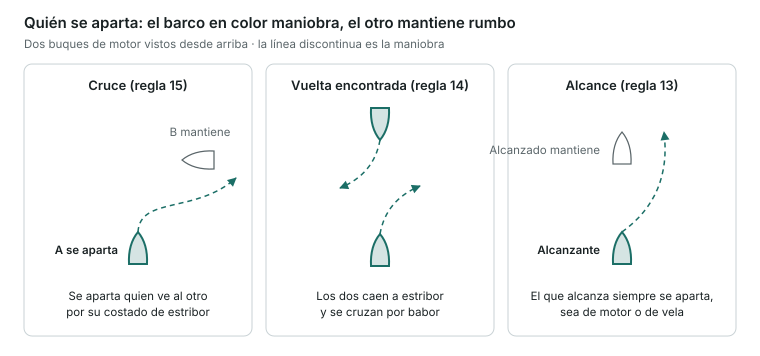
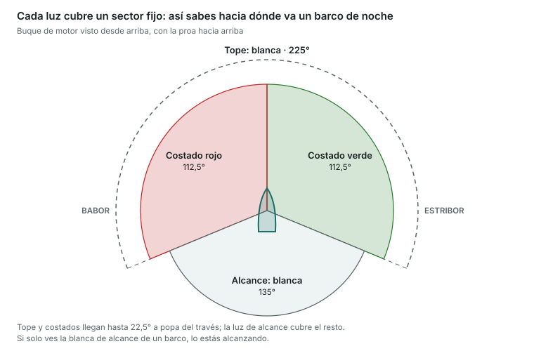

Es la unidad con más peso: 10 preguntas y eliminatoria. Tienes que dominar quién se aparta en cada situación, las luces y marcas y las señales acústicas.

## Definiciones que hay que saber

- **Buque de propulsión mecánica**: cualquiera que se mueve con motor. Un velero que navega a motor lo es, aunque lleve velas.
- **Buque de vela**: navega solo a vela.
- **Buque dedicado a la pesca**: pesca con artes que le limitan la maniobra (redes, palangres, arrastre). No incluye la pesca con caña o curricán.
- **Buque sin gobierno**: por alguna circunstancia excepcional no puede maniobrar (avería de motor o timón).
- **Buque con capacidad de maniobra restringida**: por el trabajo que hace no puede apartarse (dragados, cables submarinos, operaciones de buceo, remolques difíciles).
- **Buque restringido por su calado**: un buque grande que, por su calado respecto a la profundidad, no puede desviarse del rumbo.
- **En navegación**: no está fondeado, ni amarrado, ni varado.
- **Visibilidad reducida**: por niebla, lluvia, nieve o humo.

## Reglas de rumbo y gobierno

- **Regla 5 · Vigilancia**: hay que mantener siempre una vigilancia visual y auditiva eficaz (y con radar si se tiene).
- **Regla 6 · Velocidad de seguridad**: la que permite parar o maniobrar a tiempo según la visibilidad, el tráfico y el estado de la mar.
- **Regla 7 · Riesgo de abordaje**: hay riesgo si la **demora** del otro buque **no cambia** y la distancia disminuye. Si tienes dudas, considera que hay riesgo.
- **Regla 8 · Maniobras**: deben ser **claras, con antelación y amplias**, para que el otro las vea. Un cambio de rumbo grande es mejor que muchos pequeños. Si hace falta, reduce o para la máquina.
- **Regla 9 · Canales angostos**: navega tan cerca como puedas del lado de **estribor** del canal. Los buques de menos de 20 m y los de vela no deben estorbar a los que solo pueden navegar por el canal.
- **Regla 10 · Dispositivos de separación del tráfico**: sigue la vía de circulación en el sentido indicado. Si tienes que cruzarla, hazlo con el rumbo lo más **perpendicular** posible. Los buques de menos de 20 m no deben estorbar a los que siguen la vía.
- **Regla 12 · Dos veleros**: si reciben el viento por bandas distintas, se aparta el que lo recibe por **babor**. Si lo reciben por la misma banda, se aparta el de **barlovento**.
- **Regla 13 · Alcance**: el buque que **alcanza** siempre se aparta, sea de motor o de vela. Alcanzas cuando te acercas al otro desde más de **22,5° a popa de su través** (de noche, solo ves su luz de alcance).
- **Regla 14 · Vuelta encontrada** (dos buques de motor que se encuentran de frente): los dos caen a **estribor** y se cruzan por babor.
- **Regla 15 · Cruce** (dos buques de motor): se aparta el que ve al otro por su costado de **estribor**. Debe evitar cortarle la proa.
- **Regla 16 · Buque que cede el paso**: maniobra pronto y de forma clara.
- **Regla 17 · Buque que sigue a rumbo**: mantiene rumbo y velocidad. Si el otro no maniobra, puede maniobrar él (sin caer a babor ante un buque que tiene por babor) y, si el abordaje es inminente, debe hacer lo necesario para evitarlo.

**Regla 18 · Responsabilidades entre buques**: cada uno se aparta de los que tienen menos capacidad de maniobra, en este orden (de más a menos prioridad):

1. Sin gobierno
2. Capacidad de maniobra restringida
3. Restringido por su calado (los demás no deben estorbarle)
4. Dedicado a la pesca
5. Vela
6. Propulsión mecánica

- **Regla 19 · Visibilidad reducida**: velocidad de seguridad y máquinas listas. Si oyes una señal de niebla por la proa, reduce al mínimo de gobierno y, si hace falta, para.

En el cruce, A ve a B por estribor: A se aparta y pasa por la popa de B, que mantiene rumbo y velocidad.

## Luces de navegación

| Luz | Color | Sector | Posición |
|---|---|---|---|
| Tope (palo) | Blanca | 225° (de proa hasta 22,5° a popa del través de cada banda) | Sobre la crujía, a proa |
| Costado | Verde a estribor, roja a babor | 112,5° cada una | A cada banda |
| Alcance | Blanca | 135° | A popa |
| Remolque | Amarilla | 135° | A popa, sobre la de alcance |
| Todo horizonte | Según el caso | 360° | — |
| Centelleante | Según el caso | 120 o más destellos por minuto | — |

Si de noche ves la blanca de tope y la verde, tienes el barco por su costado de estribor; si ves la blanca y la roja, por babor.

**Alcance mínimo para buques de menos de 12 m**: tope 2 millas, costados 1 milla, alcance 2 millas, todo horizonte 2 millas.

## Qué lleva cada buque

| Buque | Luces de noche | Marca de día |
|---|---|---|
| Motor en navegación | Tope + costados + alcance | — |
| Motor de menos de 12 m | Puede sustituir tope y alcance por una blanca todo horizonte, + costados | — |
| Motor de menos de 7 m y 7 nudos o menos | Basta una blanca todo horizonte (y costados si puede) | — |
| Vela en navegación | Costados + alcance (o farol tricolor en el tope si mide menos de 20 m); opcional: roja sobre verde en el tope | — |
| Vela de menos de 7 m o a remo | Si puede, las de vela; si no, una linterna blanca a mano | — |
| Velero navegando a motor | Como un buque de motor | Un cono con el vértice hacia abajo |
| Fondeado | Una blanca todo horizonte a proa (y otra más baja a popa si mide 50 m o más) | Una bola negra a proa |
| Sin gobierno | Dos rojas todo horizonte en vertical (+ costados y alcance si tiene arrancada) | Dos bolas |
| Capacidad de maniobra restringida | Roja–blanca–roja en vertical | Bola–rombo–bola |
| Restringido por su calado | Tres rojas en vertical | Un cilindro |
| Pesca de arrastre | Verde sobre blanca | Dos conos unidos por los vértices |
| Pesca (no arrastre) | Roja sobre blanca | Dos conos unidos por los vértices |
| Práctico en servicio | Blanca sobre roja | — |
| Varado | Luces de fondeo + dos rojas en vertical | Tres bolas en vertical |
| Remolcando (remolque de más de 200 m) | Tres blancas de tope en vertical + amarilla de remolque | Un rombo |

- **Truco**: _«Verde sobre blanco, pesca arrastrando»; «blanco sobre rojo, práctico a bordo»_.
- **Dos rojas en vertical, sin gobierno**: el barco no puede maniobrar.

## Señales acústicas

Pitada **corta** ≈ 1 s. Pitada **larga** = 4 a 6 s.

| Señal | Significado |
|---|---|
| 1 corta | Caigo a estribor |
| 2 cortas | Caigo a babor |
| 3 cortas | Estoy dando atrás |
| 5 cortas o más, rápidas | No entiendo tu maniobra o dudo de que sea suficiente |
| 1 larga | Me acerco a un recodo o a una zona sin visibilidad |
| 2 largas + 1 corta | En un canal: quiero alcanzarte por tu banda de estribor |
| 2 largas + 2 cortas | En un canal: quiero alcanzarte por tu banda de babor |
| Larga–corta–larga–corta | Conformidad con el adelantamiento |

**Visibilidad reducida** (intervalo máximo de 2 minutos):

- Motor con arrancada: **1 larga**.
- Motor parado y sin arrancada: **2 largas**.
- Vela, pesca, sin gobierno, maniobra restringida, restringido por su calado o remolcando: **1 larga + 2 cortas**.
- Fondeado: **campana rápida durante 5 s** cada minuto.
- Los buques de menos de 12 m no están obligados a hacer estas señales, pero deben hacer alguna señal acústica eficaz cada 2 minutos como máximo.

## Señales de peligro (anexo IV)

Indican que un buque está en peligro y necesita ayuda: bengalas o cohetes **rojos**, humo **naranja**, la palabra **MAYDAY** por radio, **SOS** en Morse, sonido continuo de bocina, subir y bajar los brazos extendidos, las banderas **N** sobre **C**, y una señal cuadrada con una bola encima o debajo.

> **Recuerda para el examen**: cruce = quien ve al otro por estribor se aparta. Vuelta encontrada = los dos a estribor. El que alcanza siempre se aparta. Motor se aparta de vela; vela se aparta de pesca; todos se apartan del buque sin gobierno. 1 corta estribor, 2 babor, 3 atrás, 5 duda.
